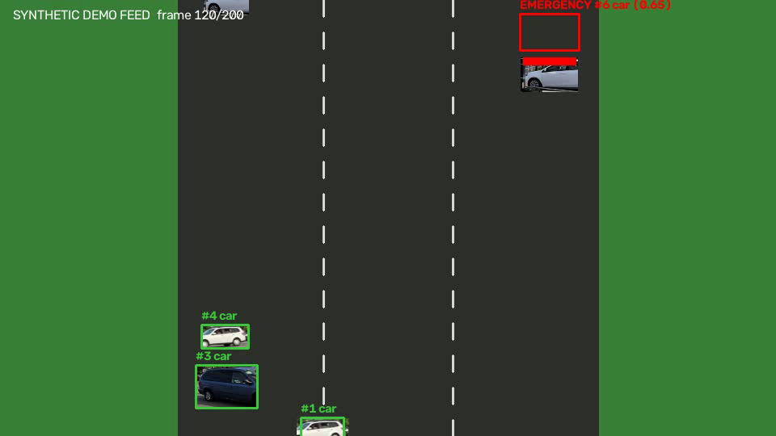

# Comprehensive Traffic Management Using Machine Learning Techniques

BCSE 497J — Project-I, VIT. Tanmay Agarwal (23BAI0172), Vishal Tiwari (23BCB0144). Faculty guide: Ushus Elizabeth Zachariah.

An AI-driven traffic management system that integrates **traffic congestion
prediction**, **priority (emergency) vehicle detection**, and **adaptive
traffic signal control** into one decision-making pipeline, aimed at
reducing urban congestion and giving emergency vehicles right-of-way. See
[`docs/architecture.md`](docs/architecture.md) for the full system design
and the reasoning behind each design choice.

## What's actually implemented

| Component | Technique | Trained on |
|---|---|---|
| Congestion prediction | Attention-pooled LSTM, multi-horizon (1h/3h/6h), dual regression + classification heads | Real data: [UCI Metro Interstate Traffic Volume](https://archive.ics.uci.edu/dataset/492/metro+interstate+traffic+volume) (~48k hourly I-94 records, 2012-2018, with weather) |
| Priority vehicle detection | YOLOv8 vehicle detection + DeepSORT tracking + siren-flicker/livery heuristics (optional CNN head) | Pretrained YOLOv8n (COCO); heuristics need no training data |
| Adaptive signal control | Deep Q-Network on a custom 4-approach intersection simulator | Self-play (no external dataset needed) |
| Integration | `DecisionEngine`: hard emergency override + congestion-biased Q-values | Fuses the three trained artifacts above |
| Demo | Flask dashboard: live MJPEG detection feed + live signal-state panel | — |

This is a genuine, runnable implementation, not a mockup: the LSTM trains on
real historical traffic data, the DQN is trained by actual environment
interaction, and YOLOv8/DeepSORT run real inference on a real traffic-camera
clip (see **Two video feeds** below). The one honestly-simulated piece is the
4-approach intersection dynamics (a lightweight custom simulator rather than
SUMO) — everything else is real.



*Real vehicle crops (from the real footage below) composited into the demo scene, run through the actual YOLOv8 + DeepSORT pipeline: green boxes are tracked traffic, the red box is the flagged "emergency" vehicle with its strobing light bar visible.*

## Two video feeds, on purpose

A COCO-pretrained YOLOv8 does not reliably fire on flat-shaded procedural
renders (verified empirically: 0 detections across 200 synthetic frames vs.
~5 vehicles/frame on real footage), and a real video clip can't guarantee an
ambulance drives through it on cue. So the dashboard runs **both**:

- `/video_feed` — a real ~1-minute intersection clip ([Wikimedia Commons,
  CC BY-SA 4.0, © Thomas1313](https://commons.wikimedia.org/wiki/File:Intersection_Pie-IX-Sherbrooke.webm)),
  downloaded by `src/detection/download_sample_video.py` — proves detection
  and tracking genuinely work on real video.
- `/video_feed_emergency` — a deterministic synthetic clip
  (`src/detection/synthetic_video.py`) with a strobing red/blue "ambulance" —
  proves the emergency-detection + signal-preemption feature specifically,
  on demand, without waiting for a real ambulance to pass through frame.

## Project structure

```
config.py                    # central paths & hyperparameters
src/congestion/               # LSTM congestion forecaster
src/detection/                 # YOLOv8 + DeepSORT + emergency classifier
src/signal_control/            # DQN + intersection simulator + fixed-time baseline
src/integration/                # DecisionEngine + end-to-end demo
dashboard/                     # Flask live demo
data/, models/, results/       # datasets, checkpoints, plots/metrics (mostly gitignored)
docs/architecture.md           # system design write-up
tests/test_smoke.py            # fast, model-free correctness tests
run_pipeline.py                # runs the full training/eval pipeline in order
```

## Setup

Requires Python 3.10+ and, ideally, an NVIDIA GPU (this was built and tested
on an RTX 4050 laptop GPU; everything also runs on CPU, just slower).

```bash
python -m venv .venv
source .venv/Scripts/activate        # Windows Git Bash / WSL
# .venv\Scripts\Activate.ps1         # Windows PowerShell

python -m pip install --upgrade pip
# PyTorch with CUDA (pick the index matching your driver; cu124 works with
# most recent NVIDIA drivers via backward compatibility):
pip install torch torchvision --index-url https://download.pytorch.org/whl/cu124
pip install -r requirements.txt
```

The congestion-prediction dataset is downloaded once, automatically handled
by `src/congestion/preprocess.py` reading from `data/raw/` — see **Reproducing
the results** below for how to fetch it if `data/raw/` is empty.

## Results

From the actual training/evaluation run used to build this repo (RTX 4050 laptop GPU; see `results/` for the full plots):

**Congestion LSTM** (test set, 7,878 held-out hours):

| Horizon | MAE (veh/hr) | RMSE | MAPE | Congestion-level accuracy | Macro F1 |
|---|---|---|---|---|---|
| +1h | 225 | 321 | 14.0% | 89.7% | 0.878 |
| +3h | 261 | 372 | 14.9% | 88.2% | 0.864 |
| +6h | 260 | 405 | 14.2% | 87.0% | 0.850 |

**DQN adaptive signal control vs. fixed-time baseline** (30 held-out evaluation episodes, identical seeds):

| Metric | DQN adaptive | Fixed-time | Improvement |
|---|---|---|---|
| Avg. queue length/step | 20.1 vehicles | 33.8 vehicles | **-40.4%** |
| Throughput | 560.5 veh/episode | 522.3 veh/episode | **+7.3%** |
| Avg. emergency-vehicle wait/step | 0.027 | 0.078 | **-65.4%** |

Plots: `congestion_training_curves.png`, `congestion_pred_vs_actual.png`,
`congestion_confusion_matrix.png`, `rl_training_curves.png`,
`rl_vs_baseline_comparison.png`, `end_to_end_demo_trace.png`.

## Reproducing the results

Run everything in order with one command:

```bash
python run_pipeline.py
```

...or run each stage individually (useful for iterating on one component):

```bash
# 1. Congestion prediction
python -m src.congestion.preprocess     # cleans data, builds sliding windows -> data/processed/
python -m src.congestion.train          # trains the LSTM -> models/congestion_lstm.pt
python -m src.congestion.evaluate       # test-set metrics + plots -> results/

# 2. Priority vehicle detection (no training needed; generates its own demo clip)
python -m src.detection.video_pipeline  # smoke-tests YOLOv8 + DeepSORT + emergency heuristics

# 3. Adaptive signal control
python -m src.signal_control.train_rl     # trains the DQN -> models/dqn_signal_control.pt
python -m src.signal_control.evaluate_rl  # DQN vs. fixed-time comparison -> results/

# 4. Integrated decision engine (uses the real trained LSTM + DQN together)
python -m src.integration.run_end_to_end_demo

# 5. Live dashboard (all three components running together, continuously)
python dashboard/app.py   # then open http://127.0.0.1:5000
```

`pytest tests/test_smoke.py -v` runs fast, model-free correctness checks
(environment dynamics, decision-engine emergency override logic, etc.) —
useful to run first if something in the pipeline above fails.

## Honest limitations (and how the code is structured around them)

- **No licensed CCTV footage of an actual emergency vehicle ships with this
  repo** (real footage of an ambulance running a real intersection, on
  demand, isn't something you can just download). `src/detection/synthetic_video.py`
  generates a deterministic stand-in clip (cars + an occasional
  strobing-light-bar "ambulance") specifically to demo emergency detection +
  preemption reliably. Ordinary vehicle detection is demoed on the *real*
  clip described above. Point `VideoPipeline` at any real video file or
  webcam index instead — nothing else in the pipeline changes.
- **No labeled emergency-vehicle image dataset ships with this repo either**,
  so emergency classification runs on physically-motivated heuristics
  (light-bar flicker, high-visibility livery) rather than a trained
  classifier. `src/detection/train_emergency_cnn.py` is ready to fine-tune a
  MobileNetV3 head the moment a labeled dataset (e.g. from Kaggle/Roboflow)
  is dropped into `data/emergency_vehicles/`; the classifier ensembles it in
  automatically once `models/emergency_cnn.pt` exists.
  See [`docs/architecture.md`](docs/architecture.md) for how the heuristics work.
- **The intersection is a custom Gymnasium simulator, not SUMO.** SUMO is
  the standard tool in the literature this project reviewed, but needs a
  native install outside `pip`. `IntersectionEnv` models the same queueing +
  emergency-preemption dynamics that actually drive the reward, so the DQN
  training result (adaptive control beating fixed-time on queue length and
  emergency wait — see `results/rl_vs_baseline_comparison.png`) is a real,
  reproducible experimental result, just on a simpler simulator.

## Alignment with SDGs

SDG 3 (faster emergency response), SDG 9 (AI-driven ITS infrastructure),
SDG 11 (sustainable urban mobility), SDG 13 (reduced emissions via less
idling/congestion).

## References

See [`docs/architecture.md`](docs/architecture.md) and the project proposal
PDF for the full literature review (10 papers) and IEEE-formatted reference
list this project builds on.
