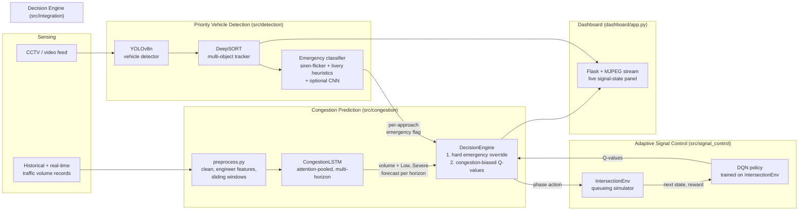

# System Architecture

## Pipeline overview

## Why this design

**Two-headed LSTM (regression + classification).** The forecaster predicts
both raw traffic volume and a discrete congestion level (Low/Medium/High/
Severe) at 1h/3h/6h horizons from the same recurrent encoder. The
classification head is trained jointly as a light regularizer -- it keeps the
learned representation aligned with decision-relevant congestion bands
instead of only curve-fitting volume -- and it's the classification output
that the decision engine actually consumes, since "is this about to become
severely congested" is a more actionable signal than a raw vehicle count.

**Detection + tracking + heuristic classification, not a single black box.**
YOLOv8 finds vehicles; DeepSORT gives each one a stable ID across frames so
evidence can accumulate over time; the emergency classifier then looks for
temporal signal (a strobing light bar) that a single-frame classifier
structurally cannot see. This is why tracking is a separate stage rather
than just running detection on every frame independently.

**No labeled emergency-vehicle dataset shipped with the project** (see
Research Gap in the original proposal -- data availability across sources is
called out explicitly), so the emergency classifier is built to work
out-of-the-box on heuristics alone, with an optional CNN head
(`train_emergency_cnn.py`) that ensembles in automatically the moment a
checkpoint exists at `models/emergency_cnn.pt`. Nothing has to change in the
detection pipeline to use it once trained.

**Custom Gymnasium environment instead of SUMO.** SUMO is the standard
choice in the literature reviewed (see docs -- AI-Powered Traffic Signal
Control for Lower Emissions in Smart Cities uses SUMO + DQN) but requires a
heavyweight native install outside Python's package manager. `IntersectionEnv`
models exactly the two things that drive the reward -- per-approach queueing
and emergency-vehicle presence -- as a lightweight, fully-Python simulator so
the whole project installs with `pip` and trains on a laptop GPU in minutes.
Swapping in a SUMO-backed environment later only requires implementing the
same `reset()`/`step()` contract.

**Hard override + soft bias, not a single learned policy.** Emergency
preemption is implemented as a hard rule in `DecisionEngine`, not left to the
DQN's discretion -- a false negative there has real safety consequences, so
it isn't something we want a black-box policy learning "usually." Congestion
forecasts, by contrast, bias the Q-values rather than dictating the action,
because the forecast is a *probabilistic* signal and the DQN's live queue
observations are more reliable ground truth for the current instant.

## Directory map

| Path | Responsibility |
|---|---|
| `src/congestion/` | Data prep, LSTM model, training, evaluation, inference wrapper |
| `src/detection/` | YOLOv8 detection, DeepSORT tracking, emergency classification, real-clip downloader, synthetic demo video |
| `src/signal_control/` | Intersection simulator, DQN agent, training, fixed-time baseline, evaluation |
| `src/integration/` | DecisionEngine (fuses all three ML components) + end-to-end demo script |
| `dashboard/` | Flask app: two live MJPEG detection feeds (real + synthetic) + live signal-state panel |
| `data/` | `raw/` (downloaded congestion dataset), `processed/` (cached windows), `samples/` (real demo clip + extracted vehicle crops), `synthetic/` (generated demo clip) |
| `models/` | Trained checkpoints (`.pt`) |
| `results/` | Plots and metrics JSON produced by training/evaluation scripts |
